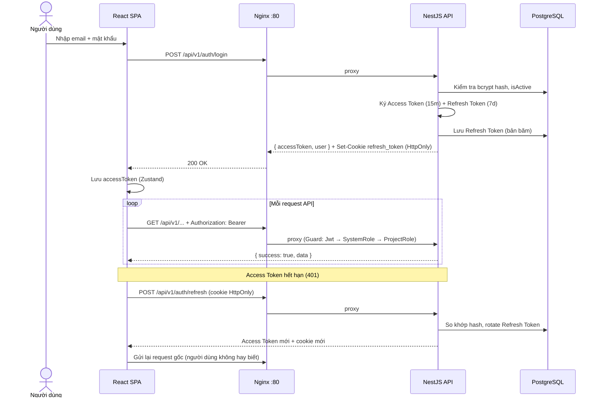
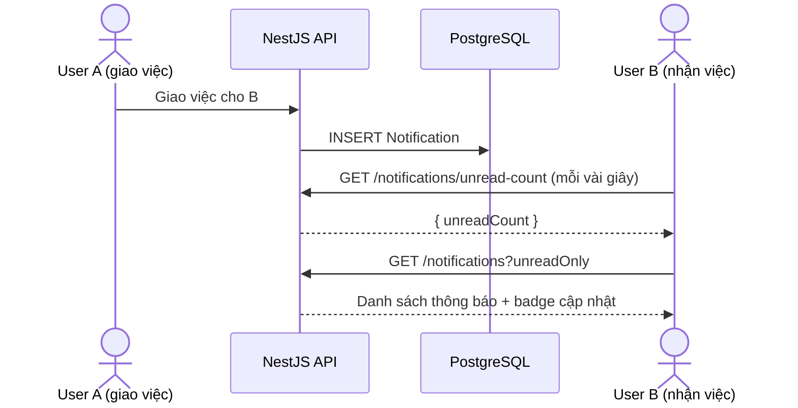
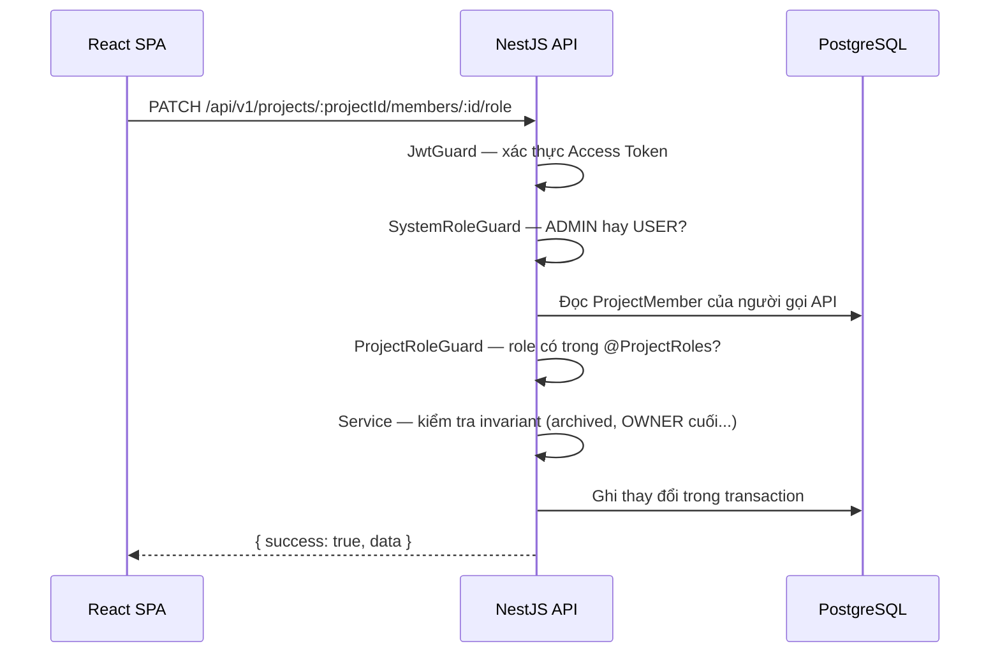

# TTeamFlow — Hệ thống quản lý dự án nhóm trực quan với Kanban

Ứng dụng web fullstack quản lý dự án nhóm: bảng Kanban kéo thả, công việc nhiều người thực hiện, thống kê khối lượng, nhật ký hoạt động và thông báo.

- Frontend: React + Vite + TypeScript
- Reverse proxy/static server: Nginx
- Backend: NestJS REST API
- ORM: Prisma
- Database: PostgreSQL
- Auth: JWT Access Token + Refresh Token (HttpOnly cookie)
- Authorization: RBAC 2 tầng
  - SystemRole: `ADMIN`, `USER`
  - ProjectRole: `OWNER`, `MANAGER`, `MEMBER`, `VIEWER`

---

## 1. Kiến trúc

```text
Browser
   |
   v
Nginx :80                      ← container frontend
   |------ /        --------> React SPA (file tĩnh)
   |------ /api/*   --------> NestJS :3000         ← container backend
   |------ /uploads/ --------> NestJS (ảnh đại diện)
                                   |
                                   v
                                 Prisma ORM
                                   |
                                   v
                        PostgreSQL :5432       ← container postgres
```

Docker Compose — 3 container: trình duyệt **chỉ đi qua Nginx**; backend không publish cổng ra ngoài; backend kết nối DB bằng hostname `postgres`, không dùng `localhost`.

### 1.1. Luồng đăng nhập & tự làm mới token



### 1.2. Luồng kéo thả task trên Kanban

```mermaid
sequenceDiagram
    actor U as Thành viên (MEMBER+)
    participant FE as React SPA
    participant BE as NestJS API
    participant DB as PostgreSQL

    U->>FE: Kéo thẻ task sang cột khác
    FE->>FE: Đổi giao diện NGAY (optimistic update)
    FE->>BE: PATCH /api/v1/tasks/:id/move {columnId, position}
    BE->>BE: Guard: Jwt → SystemRole → ProjectRole (VIEWER/ARCHIVED chặn)
    BE->>DB: Transaction + khóa dòng, cập nhật columnId/position
    BE->>DB: Vào cột hoàn thành → completedAt = NOW(); rời khỏi → completedAt = null
    BE->>DB: Ghi ActivityLog + Notification
    BE-->>FE: { success: true, data }
    FE->>FE: Đồng bộ cache TanStack Query theo trạng thái server

    Note over FE,BE: Thất bại → FE rollback giao diện về trạng thái cũ
```

### 1.3. Luồng thông báo (polling)



### 1.4. Luồng phân quyền 2 tầng



---

## 2. Chạy bằng Docker

### Lần đầu clone về

```bash
# 1. Tạo file .env
cp .env.example .env
# Điền các giá trị thật vào .env (JWT secrets, v.v.)

# 2. Build và khởi động toàn bộ services
docker compose up --build

# 3. Chạy migration (mở terminal mới)
docker compose exec backend npx prisma migrate deploy

# 4. Seed dữ liệu mẫu
docker compose exec backend npx tsx prisma/seed.ts
```

Truy cập: **http://localhost**

### Khi pull code mới về (có migration mới)

```bash
git pull
docker compose up --build
docker compose exec backend npx prisma migrate deploy
```

### Dừng / khởi động lại

```bash
# Dừng
docker compose down

# Khởi động lại (không cần build lại)
docker compose up

# Xoá toàn bộ data (reset DB)
docker compose down -v
docker compose up --build
docker compose exec backend npx prisma migrate deploy
docker compose exec backend npx tsx prisma/seed.ts
```

---

## 3. Chạy development (local, không dùng Docker)

> Yêu cầu: PostgreSQL đang chạy local, đã tạo database `project_management`.

**Backend:**

```bash
cd backend
cp .env.example .env
# Sửa DATABASE_URL trong .env trỏ đến DB local
npm install
npx prisma migrate deploy
npx tsx prisma/seed.ts
npm run start:dev
```

**Frontend:**

```bash
cd frontend
cp .env.example .env
npm install
npm run dev
```

### Khi pull code mới về

```bash
git pull

# Nếu có migration mới:
cd backend && npx prisma migrate deploy

# Nếu có package mới:
npm install
```

### Kiểm thử backend

```bash
cd backend
npm run test:all
```

---

## 4. Tài khoản seed

```text
Admin:
admin@example.com
Admin@123

Member:
member@example.com
Member@123
```

CHỈ dùng cho development.

---

## 5. Các tính năng chính

| Nhóm | Chức năng |
|---|---|
| Xác thực | Đăng ký, đăng nhập, đổi mật khẩu |
| Dự án & thành viên | Tạo, lưu trữ (read-only), mời, đổi vai trò |
| Bảng Kanban | Cột tùy chỉnh, kéo thả task |
| Công việc | Ưu tiên, hạn chót, nhiều người thực hiện (TaskAssignment) |
| Checklist & bình luận | Nhiệm vụ phụ có vòng tiến độ, bình luận nhắc tên @ |
| Tổng quan | Tiến độ, khối lượng từng thành viên, xuất CSV |
| Nhật ký hoạt động | Append-only, ghi lại mọi thao tác quan trọng |
| Thông báo | Giao việc, nhắc tên, đổi trạng thái |
| Quản trị | Tài khoản ADMIN: tìm kiếm, khóa/mở khóa người dùng |

---

## 6. Workflow khi thay đổi schema Prisma

> Áp dụng khi bạn thêm/sửa/xoá model trong `backend/prisma/schema.prisma`.

```bash
# 1. Sửa schema.prisma theo nhu cầu

# 2. Tạo migration file (chạy local, KHÔNG trong Docker)
cd backend
npx prisma migrate dev --name <tên_thay_đổi>

# 3. Commit CẢ migration file lên git
git add prisma/migrations
git commit -m "feat(<module>): add <tên_thay_đổi>"
```

> ⚠️ **Không bao giờ** sửa file trong `prisma/migrations/` sau khi đã commit/merge.

---

## 7. Quy ước kiến trúc Backend

Không chia toàn dự án thành `controllers/`, `services/`, `dto/` — mỗi business capability là một module:

```text
modules/
  auth/          users/           projects/
  project-members/ kanban/        tasks/
  dashboard/     activity-logs/   notifications/
  checklists/    comments/        admin/
```

- **Controller**: HTTP only — validate DTO, đọc user hiện tại, gọi service. Không viết Prisma query trực tiếp.
- **Service**: business logic, transaction, kiểm tra quyền, gọi PrismaService.
- **Prisma**: chỉ truy cập qua `PrismaService`, không `new PrismaClient` rải rác.
- **Ghi nhiều bảng**: bắt buộc dùng transaction.
- **Quyền**: kiểm tra ở backend bằng Guard + trong Service, không tin giao diện.

### Chuẩn một request

```text
Request → Helmet/CORS → ValidationPipe (DTO whitelist)
        → JwtGuard → SystemRoleGuard → ProjectRoleGuard
        → Controller → Service → Prisma → PostgreSQL
Phản hồi thống nhất:
  thành công: { success: true,  data: ... }
  lỗi:        { success: false, statusCode, message }
```

### Chi tiết bảo mật

- JWT 2 token: Access 15 phút + Refresh 7 ngày trong cookie HttpOnly; frontend tự refresh khi gặp 401
- Mật khẩu băm bcrypt, bắt buộc độ mạnh; Refresh Token chỉ lưu bản băm trong DB
- Đổi mật khẩu thu hồi mọi phiên đang có; tài khoản bị khóa không dùng được token cũ
- Giới hạn đăng nhập 10 lần/15 phút; DTO whitelist từ chối trường thừa; Helmet + CORS giới hạn nguồn
- Kiểm tra chữ ký thật của ảnh đại diện

---

## 8. Quy ước RBAC

### System role — `users.systemRole`

```text
ADMIN   — quản trị nền tảng, thao tác trên mọi dự án
USER    — người dùng thường
```

### Project role — `project_members.role`

| Quyền thao tác | OWNER | MANAGER | MEMBER | VIEWER |
|---|:-:|:-:|:-:|:-:|
| Xem bảng, task, tổng quan, nhật ký | ✓ | ✓ | ✓ | ✓ |
| Tạo, sửa, kéo thả, gán người, bình luận | ✓ | ✓ | ✓ | ✗ |
| Xóa task, quản lý cột, mời & đổi vai trò | ✓ | ✓ | ✗ | ✗ |
| Sửa, lưu trữ, khôi phục dự án | ✓ | ✓ | ✗ | ✗ |
| Xóa dự án | ✓ | ✗ | ✗ | ✗ |

Một user có thể OWNER ở Project A nhưng MEMBER ở Project B — quyền dự án lưu trong `ProjectMember`, không lưu trong bảng User.

---

## 9. Invariants bắt buộc

1. Tạo project chạy transaction: tạo Project → creator thành OWNER → tạo TODO, DOING, DONE (`isCompleted=true`)
2. Task nhiều assignee dùng `TaskAssignment`, không thêm `assigneeId` vào Task
3. Trạng thái Done dựa vào `KanbanColumn.isCompleted` + `Task.completedAt`, không dựa vào tên cột
4. Task vào completed column → `completedAt = NOW()`; rời khỏi → `completedAt = null`
5. `ActivityLog` là append-only — không có API update/delete log
6. Archived project là read-only
7. Dự án/task xoá mềm qua `deletedAt` — giữ lịch sử, có thể khôi phục
8. Mã task theo dự án (SHOP-1, SHOP-2…) cấp trong transaction có khóa dòng, không trùng
9. Vị trí thẻ Kanban cách nhau 1000; chèn giữa lấy midpoint, sát nhau thì normalize trong transaction

---

## 10. API

Tiền tố chung: `/api/v1` — 52 endpoint REST, phản hồi thống nhất `{ success, data }` / `{ success, statusCode, message }`.

```text
GET  /api/v1/health                    — health check (public)

# Xác thực & người dùng (public: register, login, refresh, logout)
POST /api/v1/auth/login
POST /api/v1/auth/refresh
PATCH /api/v1/auth/change-password

# Dự án & thành viên
POST /api/v1/projects/:id/members

# Kanban & task
PATCH /api/v1/tasks/:id/move

# Thông báo
GET /api/v1/notifications/unread-count
```

Chi tiết đầy đủ: [`docs/API_CONVENTIONS.md`](docs/API_CONVENTIONS.md), [`docs/API_REQUEST_RESPONSE.md`](docs/API_REQUEST_RESPONSE.md), kiến trúc: [`docs/ARCHITECTURE.md`](docs/ARCHITECTURE.md).

---

## 11. Biến môi trường (`.env`)

| Biến | Mặc định | Ghi chú |
|---|---|---|
| `POSTGRES_DB` | `project_management` | |
| `POSTGRES_USER` / `POSTGRES_PASSWORD` | `postgres` | |
| `POSTGRES_PORT` | `5432` | Chỉ gắn `127.0.0.1` |
| `BACKEND_PORT` | `3000` | Chỉ expose nội bộ Docker |
| `FRONTEND_PORT` | `80` | Cổng vào duy nhất |
| `JWT_ACCESS_SECRET` | — | **Bắt buộc**, thiếu sẽ không chạy |
| `JWT_ACCESS_EXPIRES_IN` | `15m` | |
| `JWT_REFRESH_SECRET` | — | **Bắt buộc**, thiếu sẽ không chạy |
| `JWT_REFRESH_EXPIRES_IN` | `7d` | |
| `FRONTEND_ORIGIN` | `http://localhost:80` | CORS whitelist |
