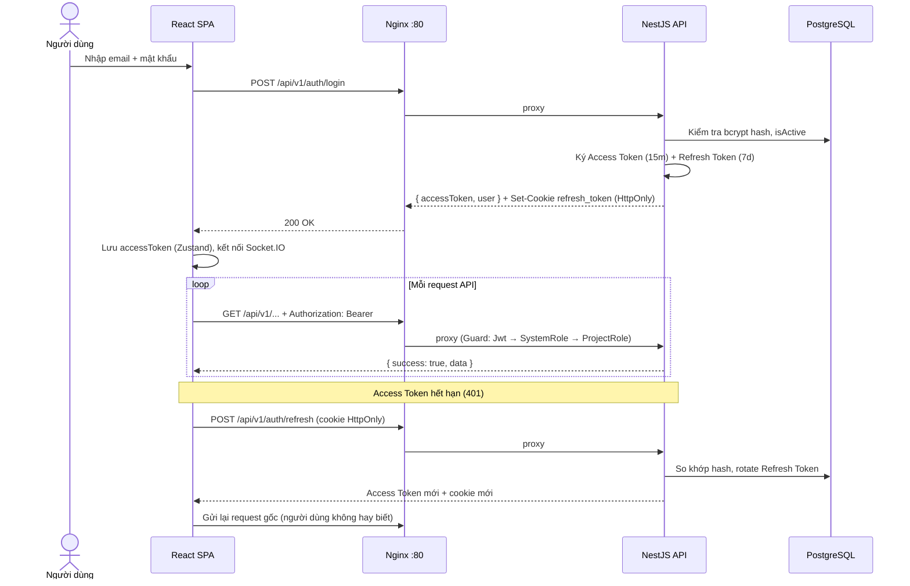
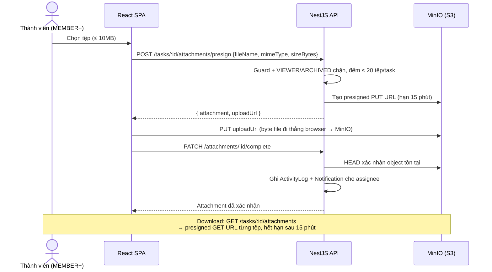
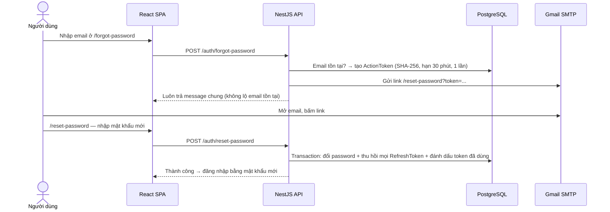

# TTeamFlow — Hệ thống quản lý dự án nhóm trực quan với Kanban

Ứng dụng web fullstack quản lý dự án nhóm: bảng Kanban kéo thả, công việc nhiều người thực hiện, thống kê khối lượng, nhật ký hoạt động và thông báo real-time.

- Frontend: React + Vite + TypeScript
- Reverse proxy/static server: Nginx
- Backend: NestJS REST API
- ORM: Prisma
- Database: PostgreSQL
- File storage: MinIO (S3-compatible)
- Auth: JWT Access Token + Refresh Token (HttpOnly cookie), quên mật khẩu & xác minh email qua SMTP
- Authorization: RBAC 2 tầng
  - SystemRole: `ADMIN`, `USER`
  - ProjectRole: `OWNER`, `MANAGER`, `MEMBER`, `VIEWER`

---

## 1. Kiến trúc

```text
Browser
   |
   v
Nginx :80                      ← container frontend
   |------ /        --------> React SPA (file tĩnh)
   |------ /api/*    --------> NestJS :3000         ← container backend
   |------ /socket.io ---------> NestJS (WebSocket)      (thông báo real-time)
   |------ /uploads/ ---------> NestJS (ảnh đại diện cũ)
                                   |
                                   v
                                 Prisma ORM
                                   |
                                   v
                        PostgreSQL :5432       ← container postgres
                        MinIO :9000 (S3 API)   ← container minio (tệp đính kèm)
```

### 1.1. Luồng đăng nhập & tự làm mới token



### 1.2. Luồng upload tệp đính kèm (presigned URL — file không qua backend)



### 1.3. Luồng thông báo real-time (Socket.IO)

```mermaid
sequenceDiagram
    actor A as User A (giao việc)
    participant BE as NestJS
    participant DB as PostgreSQL
    participant WS as Socket.IO Gateway
    actor B as User B (nhận việc)

    Note over B,WS: B đăng nhập → socket join room "user:<B>"

    A->>BE: Giao việc cho B
    BE->>DB: INSERT Notification (ghi DB trước)
    BE->>WS: emitToUser(B, "notification:new")
    WS-->>B: Đẩy event qua WebSocket
    B->>B: Toast + badge số chưa đọc + invalidate TanStack Query

    Note over B,WS: B mất mạng → socket tự reconnect;<br/>không mất thông báo vì dữ liệu đã ghi DB
```

### 1.4. Luồng quên mật khẩu



Docker — 5 service (backend chỉ giao tiếp nội bộ, trình duyệt chỉ đi qua Nginx):

| Container | Vai trò | Cổng |
|---|---|---|
| `frontend` | Nginx: SPA + reverse proxy | `80` (publish) |
| `backend` | NestJS REST API + WebSocket | `3000` (chỉ expose nội bộ) |
| `postgres` | PostgreSQL 17, volume `postgres_data` | `127.0.0.1:5432` |
| `minio` | Lưu tệp đính kèm (S3 API), volume `minio_data` | `127.0.0.1:9000` (API), `127.0.0.1:9001` (console) |
| `minio-init` | Tạo bucket `tteamflow` (private) rồi thoát | — |

Lưu ý: trong Docker, backend kết nối database bằng hostname `postgres` và MinIO bằng `minio` — tên service, không phải `localhost`.

---

## 2. Chạy bằng Docker

### Lần đầu clone về

```bash
# 1. Tạo file .env
cp .env.example .env
# Điền các giá trị thật: JWT secrets, MINIO_ROOT_PASSWORD, MAIL_USER/MAIL_PASSWORD (App Password Gmail)
# Chưa có Gmail App Password thì giữ MAIL_DEV_LOG=true (email in ra console backend)

# 2. Build và khởi động toàn bộ services
docker compose up --build

# 3. Chạy migration (mở terminal mới)
docker compose exec backend npx prisma migrate deploy

# 4. Seed dữ liệu mẫu
docker compose exec backend npx tsx prisma/seed.ts
```

Truy cập: **http://localhost** — MinIO console: http://localhost:9001

### Khi pull code mới về (có migration mới)

```bash
git pull
docker compose up --build
docker compose exec backend npx prisma migrate deploy
```

### Dừng / khởi động lại / reset

```bash
# Dừng
docker compose down

# Khởi động lại (không build lại)
docker compose up

# Xoá toàn bộ data (reset DB + MinIO)
docker compose down -v
docker compose up --build
docker compose exec backend npx prisma migrate deploy
docker compose exec backend npx tsx prisma/seed.ts
```

---

## 3. Chạy development (local, không dùng Docker)

> Yêu cầu: PostgreSQL đang chạy local, đã tạo database `project_management`.

**Backend:**

```bash
cd backend
cp .env.example .env
# Sửa DATABASE_URL trỏ đến DB local
npm install
npx prisma migrate deploy
npx tsx prisma/seed.ts
npm run start:dev
```

**Frontend:**

```bash
cd frontend
cp .env.example .env
npm install
npm run dev
```

### Kiểm thử

```bash
# Backend: toàn bộ unit test (11 bộ)
cd backend && npm run test:all

# Hoặc từng bộ
npm run test:rbac          # Phân quyền
npm run test:attachments   # Tệp đính kèm
npm run test:email-auth    # Quên mật khẩu / xác minh email

# Frontend: E2E (Playwright) — cần app đang chạy
cd frontend
npx playwright install chromium
npx playwright test
```

---

## 4. Tài khoản seed

```text
Admin:
admin@example.com
Admin@123

Member:
member@example.com
Member@123
```

CHỈ dùng cho development.

---

## 5. Các tính năng chính

| Nhóm | Chức năng |
|---|---|
| Xác thực | Đăng ký, đăng nhập, đổi mật khẩu, **quên mật khẩu qua email**, **xác minh email** |
| Dự án & thành viên | Tạo, lưu trữ (read-only), mời, đổi vai trò |
| Bảng Kanban | Cột tùy chỉnh, kéo thả task, vị trí cách nhau 1000 đơn vị |
| Công việc | Ưu tiên, hạn chót, nhiều người thực hiện (TaskAssignment) |
| Checklist & bình luận | Nhiệm vụ phụ có vòng tiến độ, bình luận nhắc tên @ |
| **Tệp đính kèm** | Upload ảnh/tài liệu ≤ 10MB qua MinIO, presigned download URL |
| Tổng quan | Tiến độ, khối lượng từng thành viên, xuất CSV |
| Nhật ký hoạt động | Append-only, ghi lại mọi thao tác quan trọng |
| Thông báo | Giao việc, nhắc tên, đổi trạng thái — **real-time qua WebSocket** |
| Quản trị | Tài khoản ADMIN: tìm kiếm, khóa/mở khóa người dùng |

---

## 6. Workflow khi thay đổi schema Prisma

> Áp dụng khi bạn thêm/sửa/xoá model trong `backend/prisma/schema.prisma`.

```bash
# 1. Sửa schema.prisma theo nhu cầu

# 2. Tạo migration file (chạy local, KHÔNG trong Docker)
cd backend
npx prisma migrate dev --name <tên_thay_đổi>

# 3. Commit CẢ migration file lên git
git add prisma/migrations
git commit -m "feat(<module>): add <tên_thay_đổi>"
```

> ⚠️ **Không bao giờ** sửa file trong `prisma/migrations/` sau khi đã commit/merge.
> ⚠️ Migration viết tay phải tự tạo enum/index trước khi dùng (`CREATE TYPE` trước `CREATE TABLE`).

---

## 7. Quy ước kiến trúc Backend

Không chia toàn dự án thành `controllers/`, `services/`, `dto/` — mỗi business capability là một module:

```text
modules/
  auth/          users/           admin/
  projects/      project-members/ kanban/
  tasks/         checklists/      comments/
  dashboard/     activity-logs/   notifications/
  attachments/
```

- **Controller**: HTTP only — validate DTO, đọc user hiện tại, gọi service. Không viết Prisma query trực tiếp.
- **Service**: business logic, transaction, kiểm tra quyền, gọi PrismaService.
- **Prisma**: chỉ truy cập qua `PrismaService`, không `new PrismaClient` rải rác.
- **Ghi nhiều bảng**: bắt buộc dùng transaction.
- **Quyền**: kiểm tra ở backend bằng Guard + trong Service, không tin giao diện.

### Chuẩn một request

```text
Request → Helmet/CORS → ValidationPipe (DTO whitelist)
        → JwtGuard → SystemRoleGuard → ProjectRoleGuard
        → Controller → Service → Prisma → PostgreSQL
Phản hồi thống nhất:
  thành công: { success: true,  data: ... }
  lỗi:        { success: false, statusCode, message }
```

### Chi tiết bảo mật

- JWT 2 token: Access 15 phút + Refresh 7 ngày trong cookie HttpOnly; frontend tự refresh khi gặp 401
- Mật khẩu băm bcrypt, bắt buộc độ mạnh; Refresh Token chỉ lưu bản băm trong DB
- Đổi/reset mật khẩu thu hồi mọi phiên đang có; tài khoản bị khóa không dùng được token cũ
- Giới hạn đăng nhập 10 lần/15 phút; DTO whitelist từ chối trường thừa; Helmet + CORS giới hạn nguồn
- Email đặt lại mật khẩu/xác minh dùng token ngẫu nhiên lưu SHA-256, một lần dùng, có hạn

---

## 8. Quy ước RBAC

### System role — `users.systemRole`

```text
ADMIN   — quản trị nền tảng, thao tác trên mọi dự án
USER    — người dùng thường
```

### Project role — `project_members.role`

| Quyền thao tác | OWNER | MANAGER | MEMBER | VIEWER |
|---|:-:|:-:|:-:|:-:|
| Xem bảng, task, tổng quan, nhật ký | ✓ | ✓ | ✓ | ✓ |
| Tạo, sửa, kéo thả, gán người, bình luận | ✓ | ✓ | ✓ | ✗ |
| Đính kèm / xoá tệp | ✓ | ✓ | ✓ (tệp của mình) | ✗ |
| Xóa task, quản lý cột, mời & đổi vai trò | ✓ | ✓ | ✗ | ✗ |
| Sửa, lưu trữ, khôi phục dự án | ✓ | ✓ | ✗ | ✗ |
| Xóa dự án | ✓ | ✗ | ✗ | ✗ |

Một user có thể OWNER ở Project A nhưng MEMBER ở Project B — quyền dự án lưu trong `ProjectMember`, không lưu trong bảng User.

---

## 9. Invariants bắt buộc

1. Tạo project chạy transaction: tạo Project → creator thành OWNER → tạo TODO, DOING, DONE
2. Task nhiều assignee dùng `TaskAssignment`, không thêm `assigneeId` vào Task
3. Trạng thái Done dựa vào `KanbanColumn.isCompleted` + `Task.completedAt`, không dựa vào tên cột
4. Task vào completed column → `completedAt = NOW()`; rời khỏi → `completedAt = null`
5. `ActivityLog` là append-only — không có API update/delete log
6. Archived project là read-only
7. Dự án/task xoá mềm qua `deletedAt` — giữ lịch sử, có thể khôi phục
8. Mã task theo dự án (SHOP-1, SHOP-2…) cấp trong transaction có khóa dòng, không trùng
9. Vị trí thẻ Kanban cách nhau 1000; chèn giữa lấy midpoint, sát nhau thì normalize trong transaction
10. Bucket MinIO luôn private — mọi tải lên/xuống qua presigned URL có hạn

---

## 10. API

Tiền tố chung: `/api/v1` — 52+ endpoint REST, phản hồi thống nhất `{ success, data }` / `{ success, statusCode, message }`.

```text
GET  /api/v1/health                    — health check

# Xác thực & người dùng (public: register, login, refresh, logout,
#                         forgot-password, reset-password, verify-email)
POST /api/v1/auth/login
POST /api/v1/auth/forgot-password
POST /api/v1/auth/reset-password
POST /api/v1/auth/verify-email

# Kanban & task
PATCH /api/v1/tasks/:id/move
POST  /api/v1/tasks/:id/attachments/presign   — xin URL upload lên MinIO
PATCH /api/v1/attachments/:id/complete        — xác nhận đã upload
GET   /api/v1/tasks/:id/attachments           — danh sách + link tải

# Thông báo
GET /api/v1/notifications/unread-count
```

Chi tiết đầy đủ: [`docs/API_CONVENTIONS.md`](docs/API_CONVENTIONS.md), [`docs/API_REQUEST_RESPONSE.md`](docs/API_REQUEST_RESPONSE.md), kiến trúc: [`docs/ARCHITECTURE.md`](docs/ARCHITECTURE.md).

---

## 11. Biến môi trường (`.env`)

| Nhóm | Biến | Ghi chú |
|---|---|---|
| Database | `POSTGRES_DB`, `POSTGRES_USER`, `POSTGRES_PASSWORD`, `POSTGRES_PORT` | |
| JWT | `JWT_ACCESS_SECRET`, `JWT_REFRESH_SECRET`, `JWT_ACCESS_EXPIRES_IN` (15m), `JWT_REFRESH_EXPIRES_IN` (7d) | Bắt buộc |
| Frontend | `FRONTEND_PORT`, `FRONTEND_ORIGIN` | |
| MinIO | `MINIO_ROOT_USER`, `MINIO_ROOT_PASSWORD`, `S3_ENDPOINT`, `S3_BUCKET`, `PRESIGN_URL_TTL` | Đổi password trước khi deploy thật |
| Email | `MAIL_HOST`, `MAIL_PORT`, `MAIL_USER`, `MAIL_PASSWORD`, `MAIL_FROM`, `MAIL_DEV_LOG`, `APP_URL` | Gmail: dùng **App Password** 16 ký tự; `MAIL_DEV_LOG=true` = in email ra console, không gửi thật |

> 📧 Cách tạo Gmail App Password: Google Account → Security → bật 2-Step Verification → App Passwords. Giới hạn free: ~500 email/ngày.
